# ТЕНЬ ЧИСЛА — Shadow of Number

[](https://github.com/sergeychaliy2/detective/actions/workflows/ci.yml)
[](https://github.com/sergeychaliy2/detective/actions/workflows/release.yml)

> Детективный симулятор для математиков.
> «Преврати сухую статистику в неопровержимое доказательство.»

Игрок не "решает примеры", а ведёт нелинейное расследование на массивах данных. Математика становится не повинностью, а единственным инструментом, чтобы найти истину и спасти невиновного от тюрьмы. Каждое дело — комплексное исследование в 5 логических этапов, имитирующее реальный рабочий процесс аналитика: от первичного запроса к данным до презентации итогового вывода.

---

## Содержание

1. [Концепция](#1-концепция)
2. [Технологический стек](#2-технологический-стек)
3. [Архитектура](#3-архитектура)
4. [Структура проекта](#4-структура-проекта)
5. [Карта Riverpod-провайдеров](#5-карта-riverpod-провайдеров)
6. [Маршруты и навигация](#6-маршруты-и-навигация)
7. [Этапы расследования](#7-этапы-расследования)
8. [Гейтинг этапов](#8-гейтинг-этапов)
9. [Взаимодействия в табах](#9-взаимодействия-в-табах)
10. [Mentor-система: подсказка и лайфхак](#10-mentor-система-подсказка-и-лайфхак)
11. [Процедурная генерация улик](#11-процедурная-генерация-улик)
12. [Верификация вердикта](#12-верификация-вердикта)
13. [Машина времени](#13-машина-времени)
14. [Экзаменационный режим](#14-экзаменационный-режим)
15. [Persistence-слой](#15-persistence-слой)
16. [Кастомное окно (Window Chrome)](#16-кастомное-окно-window-chrome)
17. [Система начислений (XP, репутация, ранги)](#17-система-начислений-xp-репутация-ранги)
18. [Каталог дел](#18-каталог-дел)
19. [Дизайн-язык](#19-дизайн-язык)
20. [Тесты](#20-тесты)
21. [Математическая глубина](#21-математическая-глубина)
22. [Что готово ✅](#22-что-готово-)
23. [Roadmap 🚧](#23-roadmap-)
24. [Команды](#24-команды)
25. [Дальнейшее чтение](#25-дальнейшее-чтение)

---

## 1. Концепция

| Компонент | Содержание |
|---|---|
| **Жанр** | Детективный симулятор / serious game |
| **Платформа (MVP)** | Windows (Flutter desktop) |
| **Целевая аудитория** | Студенты прикладной математики / ИБ / финансов; junior-аналитики; преподаватели и вузы; "интеллектуальные геймеры" |
| **Уникальность** | Замена внешней мотивации (оценка) на внутреннюю (азарт расследования). Ошибка — точка роста, а не тупик. |
| **B2B-потенциал** | LMS-лицензия для вузов; платная проверка навыков кандидатов для компаний |

---

## 2. Технологический стек

| Слой | Библиотека | Зачем |
|---|---|---|
| Framework | Flutter (Dart `^3.11.4`) | Кросс-платформа, целимся на Windows |
| State | `flutter_riverpod` + `riverpod_generator` | Типобезопасный DI, удобно для тестов |
| Routing | `go_router` 14.x | Декларативный роутер с deep-links |
| Модели | `equatable` | Иммутабельные value-objects |
| UI / Шрифты | `google_fonts` — Orbitron / Rajdhani / JetBrains Mono / Inter | Техно-эстетика |
| Анимации | `flutter_animate`, `animated_text_kit`, `simple_animations`, `shimmer`, `glass_kit` | Плавные эффекты без боли |
| Окно (desktop) | `window_manager` 0.4 | Кастомный HUD-titlebar, full-screen, перехват close |
| Persistence | `shared_preferences` | Сохранение PlayerState между запусками |
| Math (свой код) | `dart:math` + чистые dart-функции | StatisticalMethods (z/IQR/MAD/Бенфорд/Spearman) + SuspectGraph (BFS, centralities) |
| Утилиты | `intl`, `logger`, `collection` | Форматирование, логирование |

---

## 3. Архитектура

Clean Architecture со срезами по фичам. Каждая фича — самостоятельный модуль с тремя слоями.

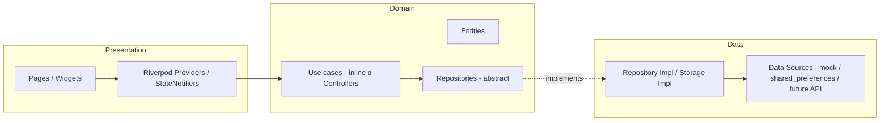

### Зависимости только в одну сторону

`presentation` → `domain` ← `data`. `domain` не знает про Flutter и Riverpod (кроме enum-ов с `Color`/`IconData` для удобства; легко выносится в presentation-mapper).

### Зависимости фич

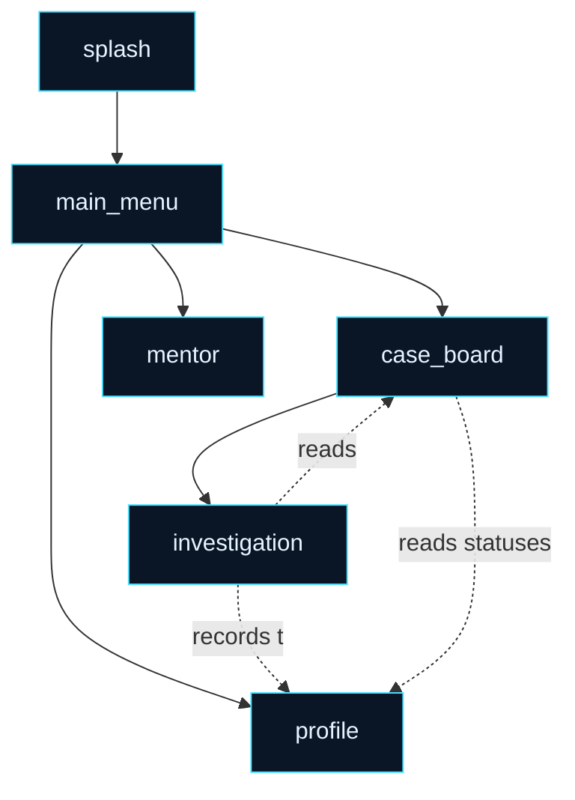

`investigation` — самая «толстая» фича. `profile` хранит сквозное состояние игрока. `case_board` оверлеит свой `CaseStatus` поверх данных репозитория, читая `playerProvider.caseStatuses`.

---

## 4. Структура проекта

```
C:\VS_Code\Detective\
├─ assets/
│  ├─ images/         # арты, фоны
│  └─ icons/          # SVG-иконки
├─ lib/
│  ├─ main.dart       # entry: SharedPreferences preload + window_manager + ProviderScope
│  ├─ app.dart        # MaterialApp.router + WindowChrome (через builder)
│  ├─ core/
│  │  ├─ theme/             # AppColors, AppTypography, AppTheme, AppMetrics
│  │  ├─ router/            # AppRouter (GoRouter + navigatorKey + fade-transitions)
│  │  └─ widgets/
│  │     ├─ backgrounds/    # GridBackground, ScanlineOverlay, ParticlesBackground, HudBackground
│  │     ├─ panels/         # NeonPanel (CustomPaint + угловые засечки + glow)
│  │     ├─ buttons/        # GlowButton (бегущая магента-линия по нижней грани)
│  │     ├─ effects/        # HolographicGlow
│  │     ├─ text/           # GlitchText
│  │     └─ window/         # WindowChrome + WindowTitleBar (traffic-lights, drag, exit confirm)
│  └─ features/
│     ├─ splash/                       # boot-sequence + автопереход в /menu
│     ├─ main_menu/                    # 5 OP-операций + статус-бар + статистика игрока
│     ├─ case_board/                   # картотека (overlay-статусы из PlayerState)
│     │  ├─ data/mock_case_repository  # MVP-сид с solutionRationale + theoryHints
│     │  └─ presentation/providers     # caseListProvider → overlayedCasesProvider
│     ├─ investigation/                # сцена расследования
│     │  ├─ data/investigation_seed    # Box-Muller шум + посадка smoking-gun
│     │  ├─ domain/
│     │  │  ├─ entities/               # ProtocolEntry, StageRequirement, AnalysisMethod,
│     │  │  │                          # AnalysisResult, DerivedColumn, ValueFilter,
│     │  │  │                          # InvestigationState
│     │  │  └─ services/               # StatisticalMethods (z/IQR/MAD/Бенфорд/Spearman),
│     │  │                             # SuspectGraph (BFS, degree, betweenness)
│     │  └─ presentation/widgets/      # tabs/, overlays/, side_rail, header, protocol_panel
│     ├─ mentor/                       # /mentor — общая теория 5 этапов
│     └─ profile/                      # PlayerState + persistence (shared_preferences)
├─ test/
│  ├─ widget_test.dart                                       # smoke MentorPage
│  └─ features/
│     ├─ profile/player_controller_test.dart                # XP, статусы, JSON, persistence
│     └─ investigation/
│        ├─ investigation_controller_test.dart              # гейтинг, методы, фильтр, экзамен, бонус
│        ├─ statistical_methods_test.dart                   # z/IQR/MAD/Бенфорд/Spearman на эталонных датасетах
│        └─ graph_metrics_test.dart                         # BFS, degree, betweenness
├─ analysis_options.yaml    # strict-casts, prefer_const, require_trailing_commas
├─ pubspec.yaml
├─ README.md                # этот файл
└─ CLAUDE.md                # правила работы для будущих AI-сессий
```

---

## 5. Карта Riverpod-провайдеров

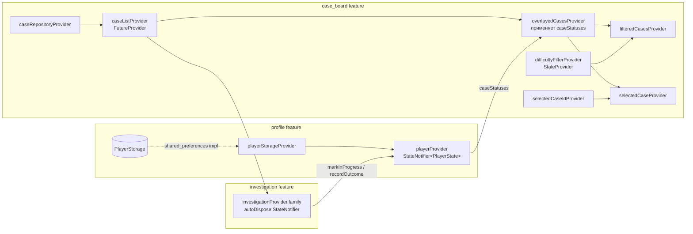

**Ключевые наблюдения:**
- `playerProvider` — единственный источник истины игрока, его `caseStatuses` оверлеятся на список дел через `overlayedCasesProvider`
- `investigationProvider.family` создаётся под конкретный `caseId`, autoDispose'ится при выходе со страницы
- При создании контроллер расследования помечает дело `inProgress` через `markInProgress` (через `Future.microtask`, чтобы не нарушать запрет Riverpod на мутации во время mount)

---

## 6. Маршруты и навигация

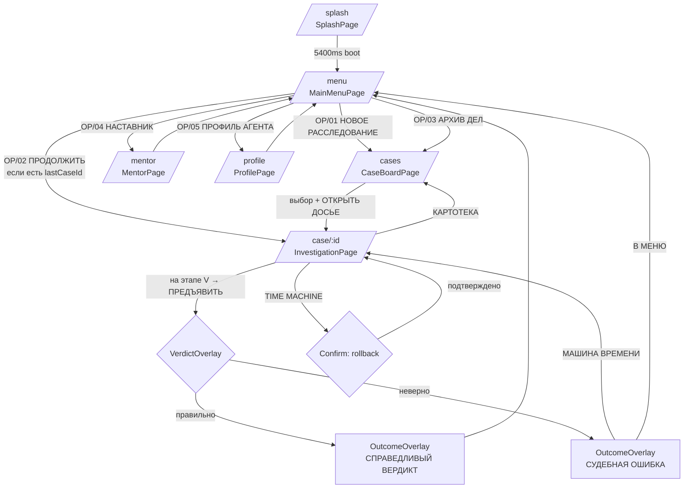

OP/02 disabled пока в `playerProvider` не появится `lastCaseId`. После `solved` — снова disabled (этот `lastCaseId` обнуляется).

---

## 7. Этапы расследования

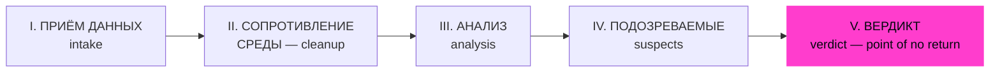

| Этап | Цель | Что делает игрок |
|---|---|---|
| **I. Приём данных** | Понять "паспорт" датасета | Просмотр сырых улик, типов, диапазонов (метрика: `evidenceViewed`) |
| **II. Сопротивление среды** | Очистить шум, дубликаты, пропуски | Постановка флагов на аномалиях (метрика: `flagsPlaced`) |
| **III. Анализ** | Найти связь там, где её не видно | Открытие ANALYSIS-вкладки (метрика: `analysisOpened`) |
| **IV. Подозреваемые** | Сопоставить улики с фигурантами | Привязка evidence → suspect (метрика: `evidenceLinked`) |
| **V. Вердикт** | Предъявить улику-цифру | Выбор подозреваемого + ввод финального числа |

---

## 8. Гейтинг этапов

Каждый этап имеет список `StageRequirement` с целевой метрикой. Кнопка «СЛЕДУЮЩИЙ ЭТАП» disabled пока хоть одно требование не выполнено. Чек-лист отрисовывается в `InvestigationHeader`.

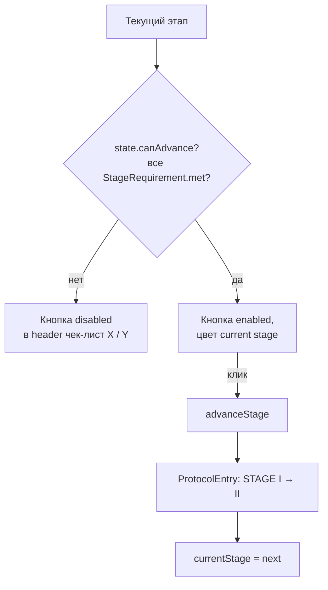

### Карта требований (`stageGateRequirements`)

| Этап | Метрика | Цель | Что игрок делает |
|---|---|---|---|
| `intake` | `evidenceViewed` | **6** | Кликает строки в DATA |
| `cleanup` | `flagsPlaced` | **2** | Тогглит FLAG ИЛИ применяет value-фильтр (фильтр считается за 1 «чистку») |
| `analysis` | `methodsApplied` | **1** | **Применяет статистический метод** (z-score / IQR / MAD / Бенфорд / Spearman) — не просто открывает вкладку |
| `suspects` | `evidenceLinked` | **2** | Выбирает улику в DATA → жмёт ПРИВЯЗАТЬ у фигуранта |
| `verdict` | — | — | Идёт в overlay через `requestVerdict` |

Метрики живут в `InvestigationState` (`viewedEvidenceIds`, `flagged-counter`, `viewedTabs`, `evidenceLinks`) — это позволяет тестировать gating отдельно от UI.

---

## 9. Взаимодействия в табах

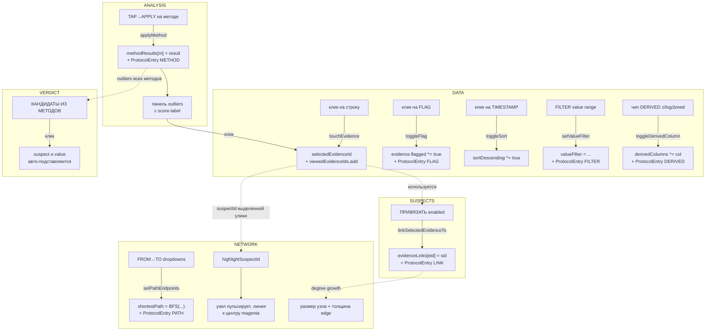

**Ключевые синхронизации:**
- `selectedEvidenceId` распространяется по DATA → SUSPECTS (включает ПРИВЯЗАТЬ) → NETWORK (подсветка носителя)
- `methodResults` подпитывает VerdictOverlay списком уникальных outliers, и подсчитывает бонус +25% за optimal-метод
- `evidenceLinks` влияют и на SUSPECTS (LINKS-счётчик), и на NETWORK (новые рёбра + пересчёт BFS-путей)

---

## 10. Mentor-система: подсказка и лайфхак

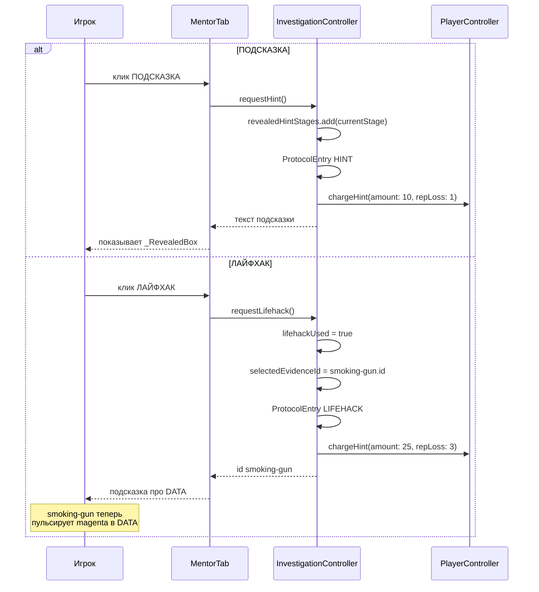

**Стоимость и ограничения:**

| Действие | XP | Reputation | Ограничения |
|---|---|---|---|
| Подсказка | −10 | −1 | 1 раз / стадия, недоступна в `exam` |
| Лайфхак | −25 | −3 | 1 раз за дело, недоступен в `exam` |

Подсказка возвращает текст из `caseInfo.theoryHints[stageIndex]`. Лайфхак подсвечивает единственную smoking-gun-улику с `isSmokingGun == true`.

---

## 11. Процедурная генерация улик

`InvestigationSeed.evidenceFor(case)` — каждый раз генерирует 28 улик по детерминированному сиду из `caseId+title`, сажая в случайное место одну smoking-gun.

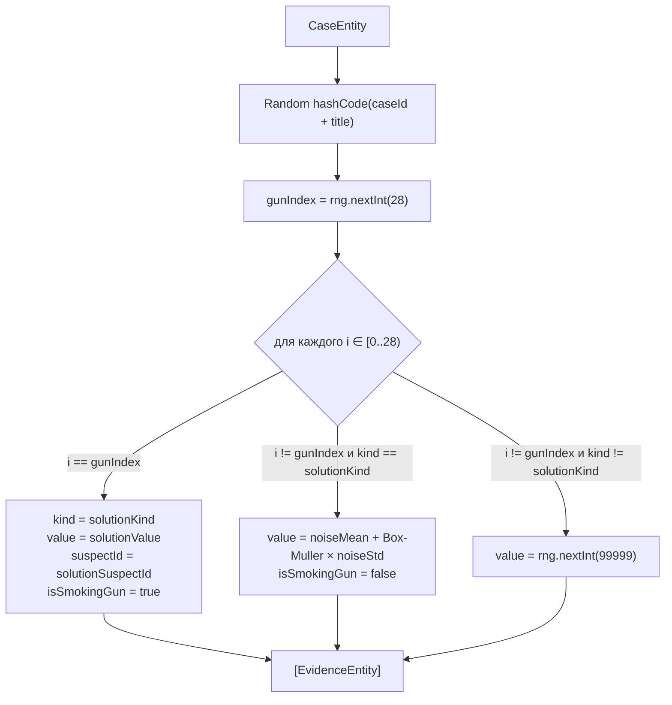

**Что это даёт:**
- Между сессиями одного дела значения те же (анти-чит на «запоминание»: сид детерминирован)
- Между разными делами — разные распределения
- Smoking-gun сидит ровно в одной улике; лайфхак подсвечивает именно её
- В `trainee`-делах smoking-gun сразу `flagged: true` — туториал «за руку»

### Шум — Box-Muller (нормальное распределение)

```dart
double _gauss(Random rng) {
  final u1 = rng.nextDouble().clamp(1e-9, 1.0);
  final u2 = rng.nextDouble();
  return sqrt(-2 * log(u1)) * cos(2 * pi * u2);
}
// value = (noiseMean + _gauss(rng) * noiseStd).round()
```

Это означает: smoking-gun реально *выпадает* из распределения штатных улик того же типа (визуально — выброс по 3σ в ANALYSIS-вкладке).

---

## 12. Верификация вердикта

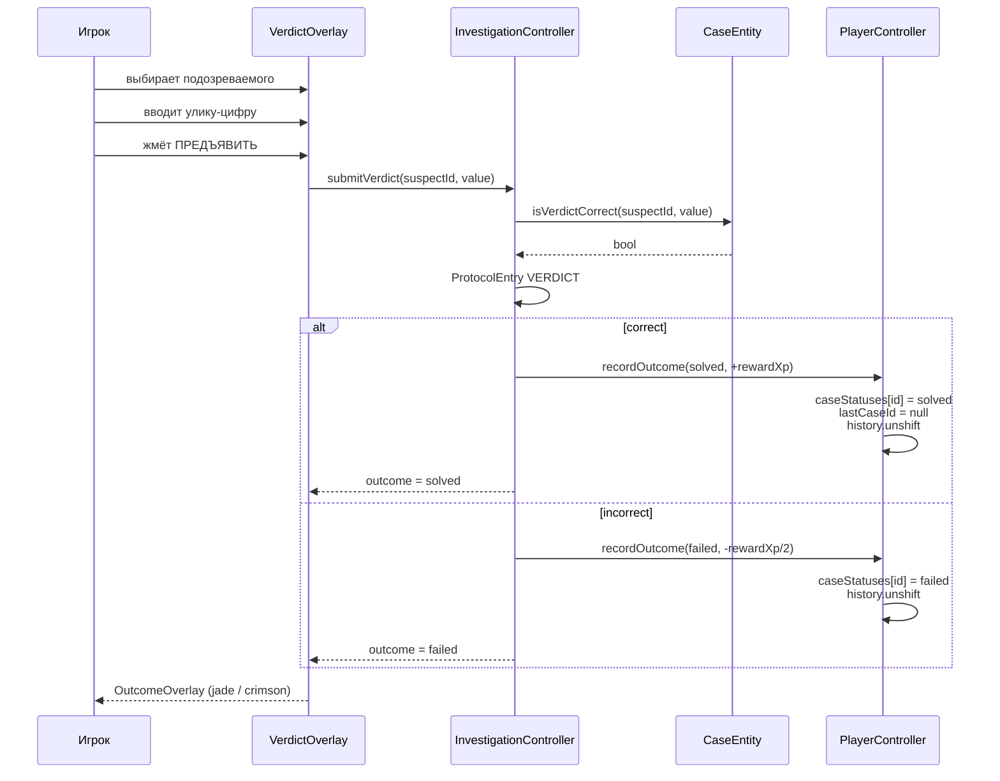

`isVerdictCorrect` (в `CaseEntity`):

```dart
bool isVerdictCorrect({required String suspectId, required num value}) {
  if (suspectId != solutionSuspectId) return false;
  return (value - solutionValue).abs() <= solutionTolerance;
}
```

---

## 13. Машина времени

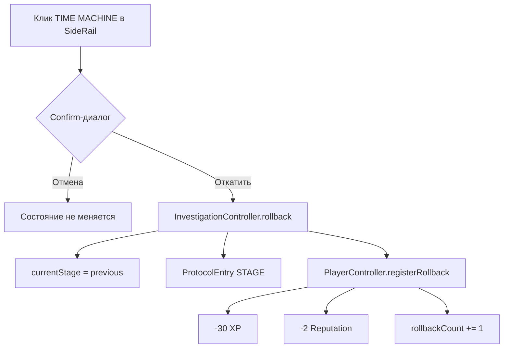

Также доступна с `OutcomeOverlay` при провале — кнопка «МАШИНА ВРЕМЕНИ» рядом с «В МЕНЮ». В экзамене — заблокирована полностью.

---

## 14. Экзаменационный режим

`CaseDifficulty.exam` отключает все «костыли»:

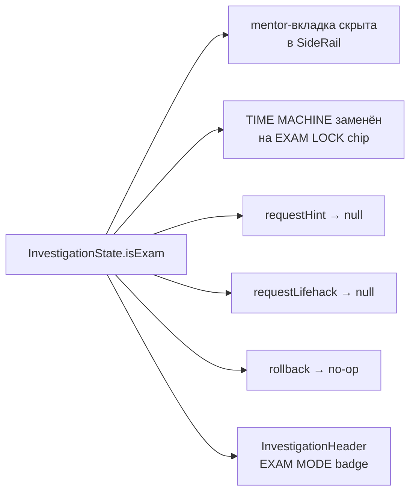

Все блокировки реализованы в самом контроллере (не только в UI), что подтверждается тестами.

---

## 15. Persistence-слой

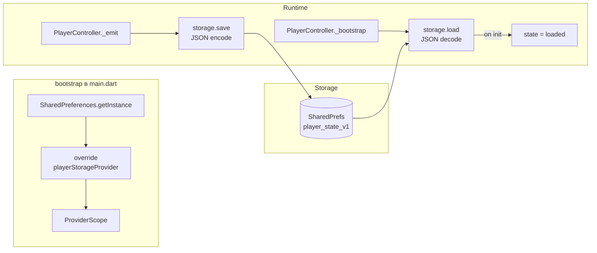

**Сохраняется:** `agent`, `xp`, `reputation`, `rollbackCount`, `lastCaseId`, `history[]`, `caseStatuses{}`. JSON-формат версионирован через ключ `player_state_v1` — миграции делать инкрементом версии и fallback-парсером.

В тестах используется `InMemoryPlayerStorage` через `playerStorageProvider.overrideWithValue(...)` — `shared_preferences` не вызывается.

---

## 16. Кастомное окно (Window Chrome)

`window_manager` 0.4 + `WindowChrome` (`lib/core/widgets/window/`) дают macOS-style HUD-titlebar и confirm на закрытие.

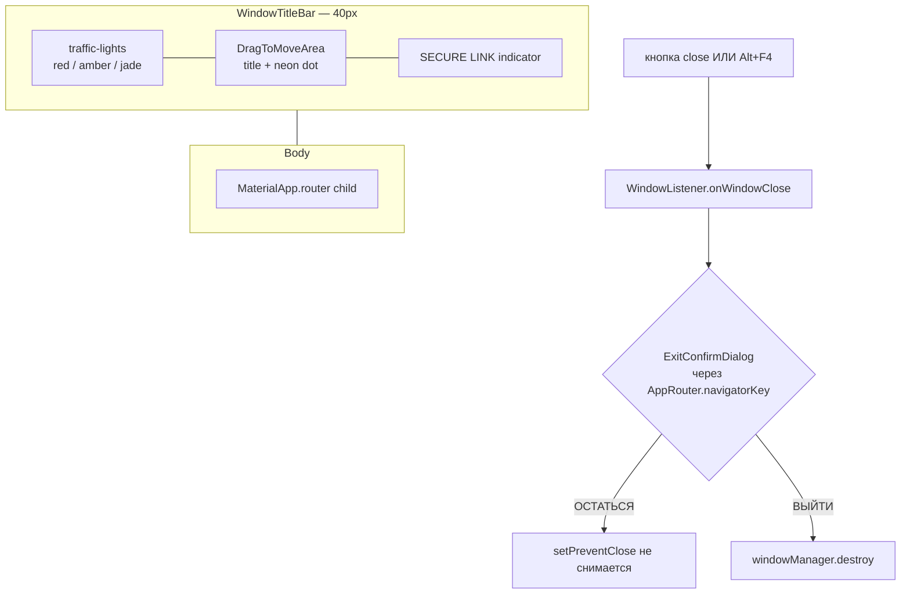

**Особенности реализации:**
- `WindowChrome` обёрнут в `MaterialApp.builder`, поэтому сидит ВЫШЕ Navigator → confirm-диалог использует `AppRouter.navigatorKey.currentContext` для `showDialog`
- `Material` нельзя использовать как обёртку (M3-tint расходился вниз и серил все NeonPanel) — стоит `ColoredBox`
- Tooltip из material требует Overlay — заменён на собственный inline-hover-icon
- `setFullScreen(true)` вызывается ПОСЛЕ `show()`, иначе Win32 не успевает отдать первый кадр

**Кнопки titlebar (left, как в macOS):**

| Цвет | Действие | Глиф (на hover) |
|---|---|---|
| 🔴 `crimsonError` | Confirm-диалог → destroy | × |
| 🟡 `amberWarning` | minimize | − |
| 🟢 `jadeSuccess` | toggle full-screen ↔ maximize | ☐ |

---

## 17. Система начислений (XP, репутация, ранги)

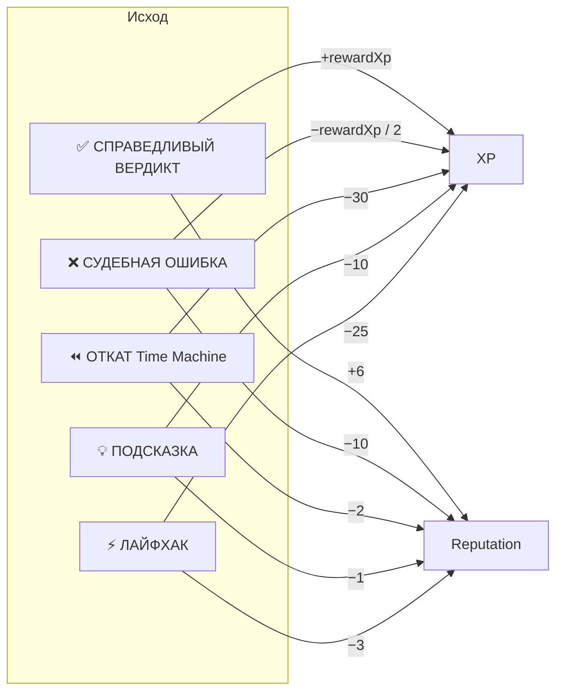

| Событие | XP | Репутация | Где задано |
|---|---|---|---|
| Закрытие дела (success) | `+rewardXp` (80–620) | `+6` | `PlayerController.recordOutcome` |
| Судебная ошибка | `-(rewardXp ~/ 2)` | `-10` | `PlayerController.recordOutcome` |
| Машина времени | `-30` | `-2` | `PlayerController.registerRollback` |
| Подсказка | `-10` | `-1` | `PlayerController.chargeHint` (1 / стадия) |
| Лайфхак | `-25` | `-3` | `PlayerController.chargeHint` (1 / дело) |

XP/репутация хранятся в `PlayerState` и переживают рестарт (см. §15).

### Ранг (вычисляется по XP)

| XP | Ранг |
|---|---|
| `0–199` | **CADET** |
| `200–799` | **JUNIOR** |
| `800–1999` | **ANALYST** |
| `2000–3999` | **SENIOR ANALYST** |
| `4000+` | **CHIEF INVESTIGATOR** |

### Точность

```
accuracy = solved / (solved + failed) × 100%
```

Откаты в `accuracy` не входят — это отдельный счётчик `rollbackCount`.

---

## 18. Каталог дел

| Код | Тема | Уровень | rewardXp | Solution suspect | Solution kind | Optimal method |
|---|---|---|---|---|---|---|
| `SN-001` ШЕПОТ В ДАННЫХ | Финансы | Trainee | 120 | S2 (ПАЛОМНИК) | TRANSACTION | **Z-SCORE** |
| `SN-002` НУЛЕВОЙ ПАЦИЕНТ | Биостатистика | Practice | 280 | S1 (ШЕРИФ) | TEST | **MAD** |
| `SN-003` ТЕНЬ ИЗБИРАТЕЛЯ | Социология | Practice | 320 | S4 (ТЕНЬ) | DOCUMENT | **БЕНФОРД-χ²** |
| `SN-004` ПОСЛЕДНИЙ ОБВАЛ | Эконометрика | Exam | 540 | S2 | TRANSACTION | **IQR** |
| `SN-005` РАСШИФРОВАННЫЙ | Криптография | Exam | 620 | S3 | MESSAGE | **SPEARMAN-ρ** |
| `SN-006` ПЕРВОЕ ПРИКОСНОВЕНИЕ | Финансы (туториал) | Trainee | 80 | S1 | TRANSACTION | **Z-SCORE** |

Применение оптимального метода даёт **+25% XP бонуса** при правильном вердикте — игрок учится подбирать метод под характер данных, а не только находить выброс.

### Уровни и допуски

| Уровень | Длительность (по ИП) | Mentor-вкладка | Подсказка / Лайфхак | Time Machine | Smoking-gun сразу flagged |
|---|---|---|---|---|---|
| **Trainee** | 15–30 мин | ✅ | ✅ | ✅ | ✅ (помощь туториала) |
| **Practice** | 45–90 мин | ✅ | ✅ | ✅ | ❌ |
| **Exam** | 2–3 часа | ❌ скрыта | ❌ заблокированы | ❌ EXAM LOCK | ❌ |

---

## 19. Дизайн-язык

| Элемент | Источник |
|---|---|
| Тёмный фон | `AppColors.voidBlack` / `deepNavy` (`#03060D` / `#071226`) |
| Главный акцент | `AppColors.neonCyan` (`#49E0FF`) |
| Вторичный акцент | `AppColors.magenta` (`#FF3DCD`) |
| Опасность / ошибка | `AppColors.crimsonError` (`#FF4D6D`) |
| Успех | `AppColors.jadeSuccess` (`#35F0A5`) |
| Warning | `AppColors.amberWarning` (`#FFB23F`) |
| Шрифты | Orbitron (display) · Rajdhani (titles) · JetBrains Mono (data) · Inter (body) |
| Базовая подложка | `HudBackground` (grid + scanline + particles) |
| Панель | `NeonPanel` (CustomPaint + угловые засечки) |
| Кнопка | `GlowButton` (бегущая магента-линия) |
| Окно | `WindowChrome` + `WindowTitleBar` (traffic-lights в нашей палитре) |

Стиль-референсы (фотографии из ИП): `C:\VS_Code\style_refs\image1..9.png`.

---

## 20. Тесты

```
test/
├─ widget_test.dart                                 # smoke MentorPage в изоляции
└─ features/
   ├─ profile/player_controller_test.dart           # 11 тестов
   │   ├─ начальное состояние
   │   ├─ recordOutcome(solved | failed)
   │   ├─ markInProgress + статусы
   │   ├─ lastCaseId clear/keep
   │   ├─ rollback
   │   ├─ rank по XP
   │   ├─ chargeHint clamp
   │   ├─ persistence (InMemoryPlayerStorage)
   │   └─ JSON round-trip
   ├─ investigation/investigation_controller_test.dart  # 15 тестов
   │   ├─ старт → in-progress + lastCaseId
   │   ├─ гейтинг intake (6 evidenceViewed)
   │   ├─ toggleFlag + ProtocolEntry
   │   ├─ linkSelectedEvidenceTo требует selection
   │   ├─ submitVerdict correct → solved + статус
   │   ├─ submitVerdict wrong → failed
   │   ├─ exam: rollback / hint / lifehack заблокированы
   │   ├─ lifehack одноразовый
   │   ├─ applyMethod сохраняет result + ProtocolEntry method
   │   ├─ гейтинг analysis: stage не сменится без applyMethod
   │   ├─ setValueFilter скрывает улики + ProtocolEntry filter
   │   ├─ toggleDerivedColumn add/remove
   │   ├─ setPathEndpoints находит shortest-path
   │   ├─ +25% бонус за optimal solutionMethod при solved
   │   └─ MockCaseRepository: solutionRationale / kindIndex валидны
   ├─ investigation/statistical_methods_test.dart       # 12 тестов
   │   ├─ describe: симметричная [1..5], std [2,4,4,4,5,5,7,9], пустой вход
   │   ├─ zScore: явный outlier выявляется, равномерные — пусто
   │   ├─ iqr: outliers за 1.5·IQR
   │   ├─ mad: устойчив против двух выбросов (z-score маскирует)
   │   ├─ benford: равномерные → χ² > 15.51, Бенфордовы → χ² < 15.51
   │   ├─ spearman: монотонно ↑ → ρ = +1, монотонно ↓ → ρ = −1
   │   └─ диспетчер: вызывает соответствующую функцию по enum
   └─ investigation/graph_metrics_test.dart             # 5 тестов
       ├─ пустые рёбра — degree = 0, нет path
       ├─ пересечение connectedEvidence создаёт ребро
       ├─ player evidenceLinks добавляют динамические рёбра
       ├─ shortest path длины 2 через промежуточный узел
       └─ betweenness промежуточного > endpoints
```

**Итого: 44/44 зелёные.** Команда: `flutter test`.

Виджет-тест полного boot через splash оказался брittle из-за `Future.delayed` в `flutter_animate` (бесконечный pending-Timer). Используется smoke на одной странице — это компромисс. Для полноценного e2e нужен `integration_test` пакет с реальным окном.

---

## 21. Математическая глубина

> Раньше игрок «угадывал выброс глазами». Теперь он **применяет статистические методы и обосновывает вердикт результатом метода**. Это не косметика — все формулы реализованы как чистые dart-функции и покрыты unit-тестами на эталонных датасетах.

### Что игрок делает математически

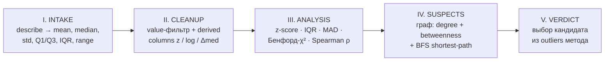

### Реализованные методы (`StatisticalMethods`)

| Метод | Метрика | Outlier-критерий | Когда применять |
|---|---|---|---|
| **DESCRIBE** | mean / median / std / Q1/Q3 / IQR | — | Всегда первым: паспорт распределения |
| **Z-SCORE** | σ | `|z| > 3` | Нормальные данные |
| **IQR** | IQR | `x ∉ [Q1−1.5·IQR, Q3+1.5·IQR]` | Не требует нормальности |
| **MAD** | MAD | `|0.6745·(x−med)/MAD| > 3.5` | Устойчив к нескольким выбросам (breakdown 50%) |
| **BENFORD** | χ² (df=8) | first-digit с `obs > exp + √exp` | Финансы, выборы — данные с большим динамическим диапазоном |
| **SPEARMAN** | ρ ∈ [−1, +1] | точки с `|Δrank| > n/4` | Поиск монотонной связи value↔time |

**Всё пишется в протокол** (`ProtocolKind.method`): «METHOD // Z-SCORE: σ = 423.5, 1 outlier(s)».

### Графовые метрики (`SuspectGraph`)

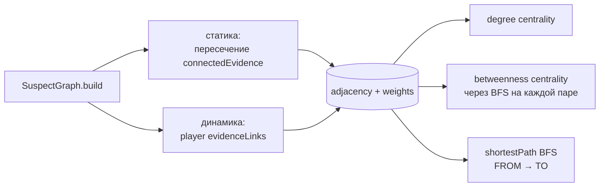

Размер узла в NETWORK = `degree`, толщина ребра = вес, путь подсвечивается magenta.

### Verdict и «элегантное решение»

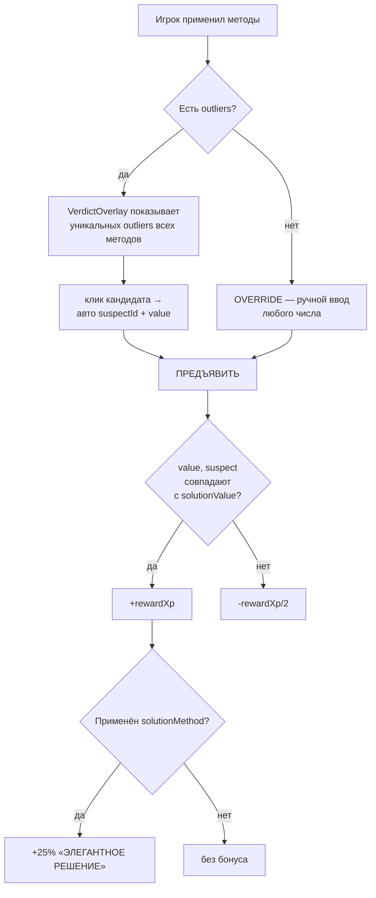

Каждое дело привязано к «оптимальному» методу (`CaseEntity.solutionMethod`) — применил его → +25% XP за вердикт. Это превращает выбор метода в значимое решение, а не косметику.

### OutcomeOverlay показывает цепочку вывода

В блоке «ЦЕПОЧКА ВЫВОДА» перечислены ВСЕ применённые методы с метрикой, числом outliers и top-outlier-улика. Под ними — финальный вердикт и `solutionRationale` дела. Это «отчёт аналитика», который можно прочитать и понять *почему* решение верное (или неверное).

### Гейтинг — теперь по-настоящему

| Этап | Метрика | Цель | Изменение |
|---|---|---|---|
| `intake` | `evidenceViewed` | 6 | Без изменений |
| `cleanup` | `flagsPlaced` (с учётом value-фильтра) | 2 | **Фильтр считается за «чистку»** |
| `analysis` | `methodsApplied` | 1 | **Раньше: «открыта вкладка». Теперь: «применён метод»** |
| `suspects` | `evidenceLinked` | 2 | Без изменений |

### Где математика покрыта тестами

- `statistical_methods_test.dart` — 12 тестов: каждый метод на эталонных датасетах с известным ответом (равномерные/Бенфордовы данные для χ², строго монотонные для ρ = ±1, известная std для [2,4,4,4,5,5,7,9])
- `graph_metrics_test.dart` — 5 тестов: degree, BFS shortest path длины 1/2, betweenness промежуточного узла > endpoints
- `investigation_controller_test.dart` — 15 тестов, в т.ч. **applyMethod**, **гейтинг analysis через метод**, **+25% бонус**, **setValueFilter**, **toggleDerivedColumn**, **setPathEndpoints**

**Итого: 44 теста, все зелёные.**

### Что осталось из «honest gap» (см. §23)

- 🟡 Пользовательский CI вместо `solutionTolerance` — учить формулировать гипотезу с доверительным интервалом
- 🟡 Tutorial-сценарии «MAD vs z-score, почему MAD устойчивее»
- 🟢 Анимация box-plot прямо во вкладке ANALYSIS под выбранным методом
- 🟢 Поддержка дополнительных методов: chi-square independence, Mann-Whitney U, KS-test

**Резюме:** математическое ядро превратилось из «декоративной σ-надписи» в реальный аналитический инструментарий: 6 методов с верифицированными формулами, графовая аналитика, обоснование вердикта, бонус за выбор оптимального метода. UX-каркас 9/10, math-глубина 7/10 (есть ещё куда расти, см. roadmap).

---

## 22. Что готово ✅

- [x] Splash с boot-sequence (typewriter + loading bar)
- [x] Главное меню: 5 операций, статистика игрока, OP/02 enable по `lastCaseId`, OP/04 → `/mentor`
- [x] Картотека дел: фильтры, шиммер-плейсхолдер, hover, правая панель деталей; статусы оверлеятся из `PlayerState`
- [x] Сцена расследования: status bar + header со шкалой 5 этапов + side rail + protocol panel + footer
- [x] **DATA**: сортировка, флаги, выделение, подсветка smoking-gun (после лайфхака), **value-range фильтр**, **derived-колонки z/log/Δmed**
- [x] **ANALYSIS**: переключатель **6 статистических методов** (DESCRIBE / Z-SCORE / IQR / MAD / БЕНФОРД-χ² / SPEARMAN-ρ); каждый отдаёт метрику + outliers + формулу + интерпретацию; descriptive-strip всегда внизу
- [x] **NETWORK**: реальный граф с **degree + betweenness centrality** через BFS; размер узла ∝ degree; толщина рёбер = вес; **FROM→TO pathfinding** с подсветкой shortest-path
- [x] SUSPECTS: карточки с привязкой выделенной улики (LINK button) + счётчик LINKS
- [x] MENTOR: typewriter-теория, ПОДСКАЗКА (−10 XP, 1/стадия), ЛАЙФХАК (−25 XP, 1/дело)
- [x] **Гейтинг этапов**: чек-лист в header; для analysis нужно реально **применить метод** (а не просто открыть вкладку)
- [x] **Протокол расследования**: 10 типов событий (FLAG / LINK / HINT / LIFEHACK / STAGE / **METHOD** / **FILTER** / **DERIVED** / **PATH** / VERDICT)
- [x] **VerdictOverlay из методов**: блок «КАНДИДАТЫ ИЗ МЕТОДОВ» — outliers всех применённых методов, клик → авто suspect+value; OVERRIDE для ручного ввода
- [x] **OutcomeOverlay цепочка вывода**: список применённых методов с метриками + top-outlier + финальный choice + `solutionRationale`
- [x] **+25% бонус «ЭЛЕГАНТНОЕ РЕШЕНИЕ»** — за применение `solutionMethod` дела (помечен OPTIMAL в ANALYSIS)
- [x] **Экзаменационный режим**: MENTOR-вкладка скрыта, TIME MACHINE → EXAM LOCK, hint/lifehack/rollback заблокированы
- [x] **Процедурная генерация улик**: smoking-gun сажается в нужный EvidenceKind, фон — Box-Muller шум
- [x] **Persistence**: `shared_preferences` хранит PlayerState (XP, история, статусы дел, lastCaseId)
- [x] Time Machine: confirm-диалог + откат (выкл в экзамене)
- [x] **Кастомное окно**: window_manager + traffic-light HUD-titlebar + confirm на выход + full-screen старт
- [x] Профиль агента: identity card, 6 метрик, журнал дел
- [x] Роутер: `/splash`, `/menu`, `/cases`, `/case/:id`, `/mentor`, `/profile`
- [x] HUD-виджеты: NeonPanel, GlowButton, HudBackground, GlitchText, HolographicGlow, WindowChrome
- [x] **Чистые domain-сервисы**: `StatisticalMethods` и `SuspectGraph` (без зависимостей от Flutter, тестируются изолированно)
- [x] Тесты: **44/44 зелёные**, `flutter analyze` чист

---

## 23. Roadmap 🚧

| Приоритет | Задача | Что входит |
|---|---|---|
| 🟡 P1 | **Калибровка CI** | Вместо `solutionTolerance` игрок задаёт доверительный интервал, FAIL если интервал перекрывает нескольких фигурантов |
| 🟡 P1 | **Box-plot в ANALYSIS** | Под выбранным методом — анимированный boxplot с точками (точки выше whiskers подсвечены) |
| 🟡 P1 | **Tutorial-сценарии** | «Сравни MAD и z-score на этом датасете — почему MAD устойчивее?» — встроенные мини-задачи в SN-006 |
| 🟢 P2 | **Дополнительные методы** | Mann-Whitney U, Kolmogorov-Smirnov, chi-square independence |
| 🟢 P2 | **Конструктор дел** | Преподаватель грузит CSV + JSON-сценарий |
| 🟢 P2 | **Сообщество** | Публикация решений, реакции «Элегантный код» / «Глубокий анализ» (из ИП) |
| 🟢 P2 | **Звук** | Boot-sequence, hover, success/error, ambient |
| 🟢 P2 | **Локализация** | RU + EN labels через `intl` |
| 🟢 P2 | **integration_test** | Полноценный e2e через splash → menu → case → verdict |

---

## 24. Команды

```powershell
# Установка зависимостей
cd C:\VS_Code\Detective
flutter pub get

# Запуск (Windows desktop)
flutter run -d windows
flutter run -d windows --release   # для скриншотов / демо

# Статический анализ (должен быть чист перед коммитом)
flutter analyze

# Тесты
flutter test

# Кодогенерация (когда появятся @freezed / @riverpod аннотации)
dart run build_runner build --delete-conflicting-outputs
```

### CI/CD (GitHub Actions)

| Workflow | Когда запускается | Что делает |
|---|---|---|
| [`ci.yml`](.github/workflows/ci.yml) | каждый push/PR в `main` | `flutter analyze` + `flutter test` (44 теста) |
| [`release.yml`](.github/workflows/release.yml) | тег `v*` или вручную | `flutter build windows --release` → zip публикуется в **GitHub Releases** (по тегу) и в artifacts |

**Выпуск релиза:**
```powershell
# подними version в pubspec.yaml, затем:
git tag v0.1.0
git push origin v0.1.0
# → release.yml соберёт Windows-сборку и создаст GitHub Release с zip
```

---

## 25. Дальнейшее чтение

- `CLAUDE.md` — правила работы с проектом для будущих AI-сессий
- ИП `C:\Users\Sergey\Downloads\ИП 1.pptx` и `text_dlya_IP.docx` — исходная концепция (автор: Каширина К.А., магистрант "Управление разработкой игровых решений для бизнеса и образования")
- `C:\VS_Code\style_refs\image1..9.png` — визуальные референсы стилистики

> «Доказательства собраны. Цифры не оставили шанса. Время выносить вердикт.»
